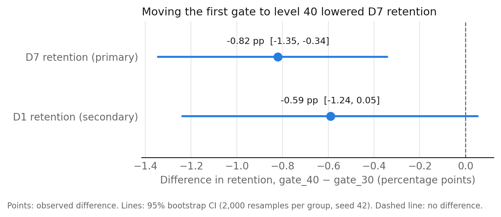
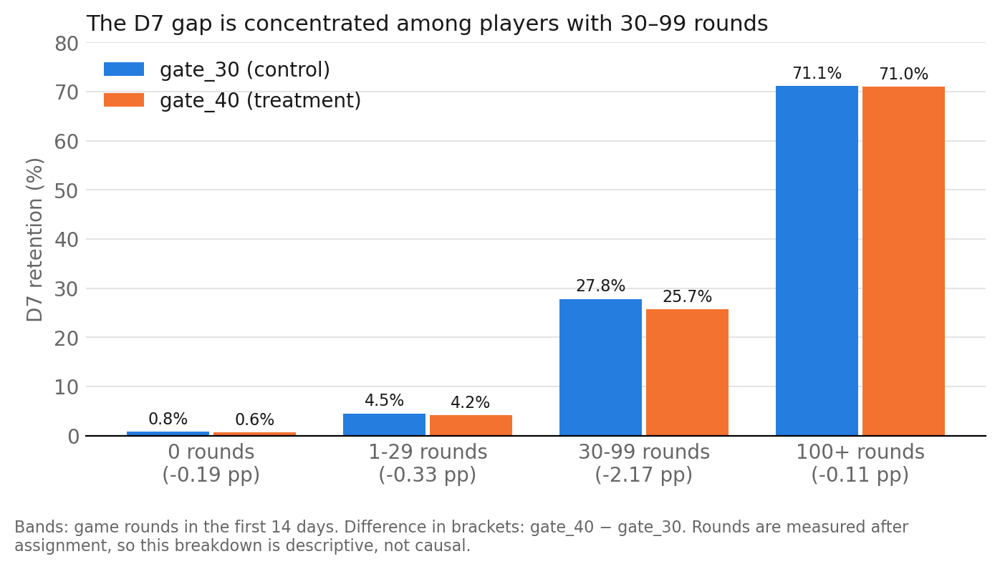
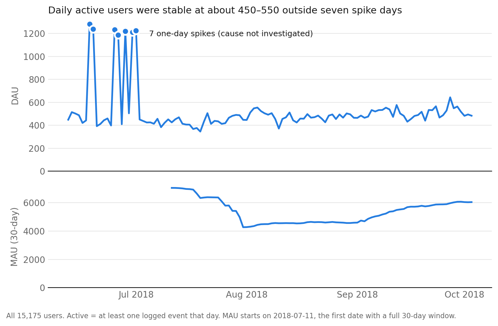
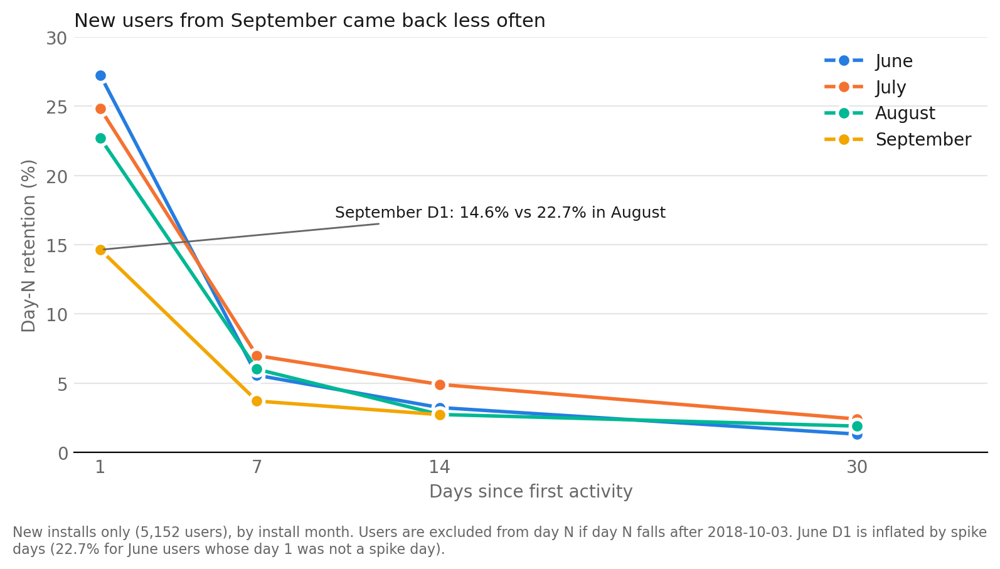
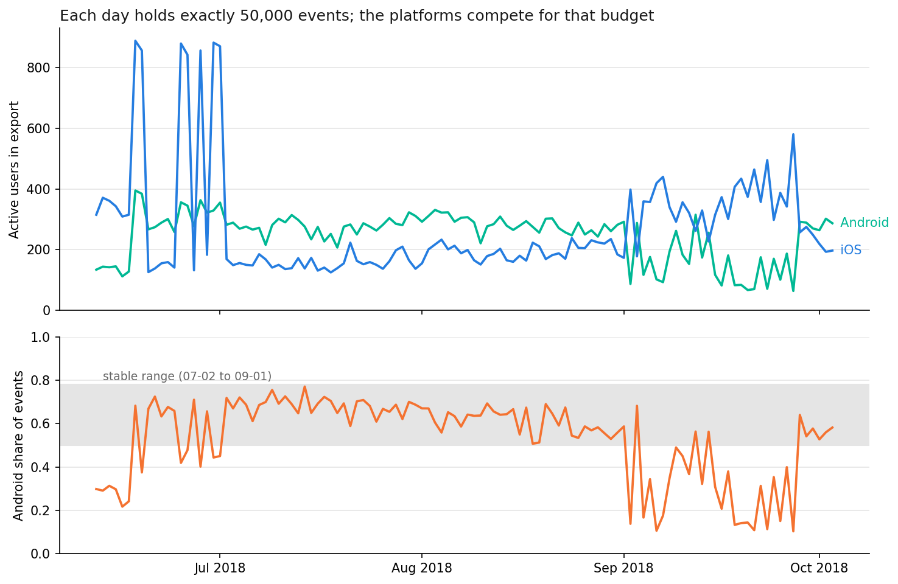

# Mobile Game Product Analytics: A/B Testing and Retention

Two analyses of real mobile-game data, written the way a product analytics team would report them.

**Key results**
- **Cookie Cats A/B test:** moving the first gate from level 30 to level 40 lowered D7 retention by 0.82 pp (95% bootstrap CI 0.34 to 1.35 pp) with no change in engagement, so the recommendation is to keep the gate at level 30.
- **Flood-It retention (BigQuery):** an apparent September drop in new-user D1 (22.7% → 14.6%) was traced to the public export's cap of exactly 50,000 events per day, not to player behavior. Android users' D1 tracks how much of that daily cap Android received (10.2% on the most crowded-out days vs 24.7% on normal days). The stage 2 conclusion was corrected accordingly.

| Module | Data | Questions |
|---|---|---|
| [`ab-test-cookie-cats/`](ab-test-cookie-cats/) | Cookie Cats A/B test (90,189 players) | Should the first gate move from level 30 to level 40? Includes a sample ratio mismatch check, two-proportion z-tests, bootstrap confidence intervals, power and minimum detectable effect, a guardrail metric, segment analysis, and a decision with limitations. |
| [`retention-flood-it/`](retention-flood-it/) | Flood-It app events in BigQuery (5.7M events, capped at 50,000 per day; 15,175 users) | How active are players, how well do new installs retain, and what explains a change in retention? Includes a user-level data model with left- and right-censoring rules, DAU/WAU/MAU and stickiness, day-N retention by install month with Wilson intervals, and a root-cause diagnosis of a retention drop (segment decomposition and a data-quality check). |

This project builds on my [GA4 funnel analysis](https://github.com/KFCkfckfc123/ga4-ecommerce-funnel-analysis). That project measured session-level conversion; this one moves to user-level retention and experimentation on a different product.

## Findings

Findings are reported stage by stage, in the order the work was done. Only results from executed code are reported, and later stages correct earlier ones where needed.

### Cookie Cats: data validation (stage 1)

Source: `ab-test-cookie-cats/notebooks/01_ab_test_analysis.ipynb`, sections 1–2.

- **Completeness:** 90,189 rows × 5 columns, matching the dataset description. `userid` is unique (90,189 distinct values) and no column has missing values.
- **Groups:** only two labels exist: `gate_30` (control) = 44,700 players and `gate_40` (treatment) = 45,489 players. Whether this split is consistent with the intended allocation is tested in the sample ratio mismatch check (stage 2).
- **Retention definition:** 3,599 players (4.0%) did not return on day 1 but did return on day 7. So `retention_7` measures activity *on* day 7 (classic day-N retention), not continuous activity through day 7. Overall, before splitting by group: D1 = 44.5%, D7 = 18.6%.
- **Engagement is heavily right-skewed:** median `sum_gamerounds` is 16 and the mean is 51.9; 3,994 players (4.4%) played zero rounds.
- **One extreme outlier:** a `gate_30` player (`userid` 6390605) logged 49,854 rounds in 14 days, about 3,561 rounds per day and 16.8 times the next highest value (2,961). The same player shows no activity on day 1. This is treated as a likely data error:
  - kept in retention analyses, where one player cannot materially change a proportion of ~45,000;
  - excluded from game-round comparisons, which are reported mainly with medians.

### Cookie Cats: sample ratio check and primary metrics (stage 2)

Source: `ab-test-cookie-cats/notebooks/01_ab_test_analysis.ipynb`, section 3. Decision rules were fixed before the results were viewed: SRM threshold p < 0.001; D7 retention as the primary metric and D1 as secondary; two-sided α = 0.05; differences reported as `gate_40 − gate_30`.

- **Sample ratio mismatch (assuming a 50/50 design):** χ² = 6.902, p = 0.0086. This does not cross the pre-set p < 0.001 threshold, so the analysis proceeds. The result is borderline (it would be flagged at 0.05), and the intended allocation is not documented, so the 789-player gap is reported as a caveat.

| Metric | gate_30 (control) | gate_40 (treatment) | Difference | z | p |
|---|---:|---:|---:|---:|---:|
| D7 retention (primary) | 19.02% | 18.20% | −0.82 pp (−4.3% relative) | 3.164 | 0.0016 |
| D1 retention (secondary) | 44.82% | 44.23% | −0.59 pp | 1.784 | 0.074 |

- **Result:** moving the first gate from level 30 to level 40 is associated with a statistically significant drop in D7 retention. The D1 difference points the same way but is not significant at α = 0.05.
- **Not yet established:** the size of the effect with a confidence interval, the test's power, and whether the effect holds across engagement segments. These are covered in stage 3.

### Cookie Cats: effect size, power, guardrail, and segments (stage 3)

Source: `ab-test-cookie-cats/notebooks/01_ab_test_analysis.ipynb`, sections 4–5.

- **Effect size (bootstrap, 2,000 resamples within each group, seed 42):** D7 difference (`gate_40 − gate_30`) = −0.83 pp, 95% CI **−1.35 to −0.34 pp**. The interval excludes zero, consistent with the z-test. Per 100,000 new players, this is roughly 340 to 1,350 fewer players active on day 7.
- **Power and minimum detectable effect (α = 0.05 two-sided, power 80%, control baseline and actual group sizes):**

| Metric | Control baseline | MDE | Relative MDE | Observed difference |
|---|---:|---:|---:|---:|
| D7 retention | 19.02% | 0.73 pp | 3.8% | −0.82 pp |
| D1 retention | 44.82% | 0.93 pp | 2.1% | −0.59 pp |

  The observed D7 drop is just above the detectable threshold. The D1 drop is below it, so the non-significant D1 result means the test could not reliably detect an effect of that size. It does **not** show that D1 was unaffected.
- **Guardrail: game rounds in the first 14 days (outlier `userid` 6390605 excluded):** median 17 (`gate_30`) vs 16 (`gate_40`); mean 51.34 vs 51.30. No meaningful difference in engagement volume.
- **D7 retention by 14-day game-round band (descriptive only):**

| Rounds band | gate_30: players / D7 | gate_40: players / D7 | Difference |
|---|---:|---:|---:|
| 0 | 1,937 / 0.83% | 2,057 / 0.63% | −0.19 pp |
| 1–29 | 26,107 / 4.51% | 26,819 / 4.18% | −0.33 pp |
| 30–99 | 10,488 / 27.84% | 10,265 / 25.67% | **−2.17 pp** |
| 100+ | 6,168 / 71.14% | 6,348 / 71.03% | −0.11 pp |

  The D7 gap is concentrated among moderately engaged players (30–99 rounds), the band in which players could plausibly reach the first gate. **Caveat:** `sum_gamerounds` is measured after assignment and may itself be affected by the gate position, so players in the same band are not directly comparable across groups. Rounds are also not levels. This breakdown generates hypotheses for a follow-up test; it is not a causal estimate for any segment.

### Cookie Cats: visualization (stage 4)

Source: `ab-test-cookie-cats/notebooks/01_ab_test_analysis.ipynb`, section 9. Images in `ab-test-cookie-cats/results/`.



**Figure 1.** The D7 interval (−1.35 to −0.34 pp) lies entirely below zero; the D1 interval (−1.24 to +0.05 pp) crosses it. The chart plots the difference itself because bars of two ~19% rates would hide a 0.8 pp gap, and a truncated axis would exaggerate it. The D1 interval is new in this stage; it uses the same bootstrap procedure and seed as D7 and agrees with the z-test (p = 0.074).



**Figure 2.** D7 retention rises steeply with engagement (under 1% for zero-round players, about 71% for 100+ rounds). The `gate_40` deficit is largest in the 30–99 band (−2.17 pp) and at most 0.33 pp elsewhere. Descriptive only, for the reasons noted in stage 3.

### Cookie Cats: decision

Source: `ab-test-cookie-cats/notebooks/01_ab_test_analysis.ipynb`, section 10.

**Recommendation: keep the first gate at level 30; do not roll out `gate_40`.** Moving the gate reduced D7 retention by 0.82 pp (95% CI 0.34 to 1.35 pp) without changing engagement volume.

Limitations that could change the decision:
- **No revenue data.** The gate is a monetization point; if `gate_40` increased purchases, the trade-off would need to be re-evaluated.
- **Borderline sample ratio** (p = 0.0086 against a pre-set 0.001 threshold; intended allocation undocumented).
- **Short horizon:** only D1, D7, and 14-day game rounds are available.

### Flood-It: data model and validation (stage 1)

Source: `retention-flood-it/sql/01_build_user_tables.sql` and `02_validate_user_tables.sql`, run in BigQuery against `firebase-public-project.analytics_153293282.events_*`.

- **Base tables:** `users` (one row per user) and `user_days` (one row per user per active day). `users` has 15,175 rows and 15,175 distinct IDs; `user_days` has 59,037 rows across all 114 days (2018-06-12 to 2018-10-03) and no duplicate user-days. No user is missing a platform (iOS 7,765, Android 7,410); 36 have no country.
- **Most users were already players before the export starts.** 9,086 users (60%) first opened the app before 2018-06-12: 5,810 in 2016–2017, 3,273 in 2018, plus 3 with implausible dates (one in 1970). Their first day in the export is not their install day, so they cannot form install cohorts. This is left-censoring.
- **New-install cohort definition.** 6,089 users first opened the app inside the window. For 5,152 of them, first open falls within one day of their first logged event (the ±1 day reflects the gap between the UTC timestamp and the export's date field). The remaining 937 have first-open dates 2–105 days before any logged activity and are excluded from cohort retention. Retention analyses use these 5,152 users, with day 0 = first logged activity.

### Flood-It: engagement and new-user retention (stage 2)

Source: `retention-flood-it/sql/03`–`05`, results in `retention-flood-it/results/`, charts from `retention-flood-it/notebooks/01_engagement_retention.ipynb`.

- **Engagement (all 15,175 users).** Average DAU was 518; average MAU (30-day window, from 2018-07-11) was 5,361; average DAU/MAU stickiness was 9.2% (range 5.3%–12.6%). On seven isolated days in late June and early July, DAU roughly doubled to about 1,200, then returned to normal the next day. Outside those days, DAU stayed between 346 and 644. The cause of the spikes was not investigated.



- **Pooled day-N retention for new installs (95% Wilson CIs).** Most churn happens in the first day; the curve flattens after the first week.

| Metric | Eligible users | Retention |
|---|---:|---:|
| D1 | 5,083 | 21.5% (20.4–22.7%) |
| D7 | 4,798 | 5.5% (4.9–6.2%) |
| D14 | 4,493 | 3.4% (2.9–4.0%) |
| D30 | 3,676 | 1.9% (1.5–2.4%) |

- **Retention by install month.** D1 was 27.2% (June), 24.8% (July), 22.7% (August), and 14.6% (September). September's D1 drop against August (−8.1 pp) is statistically significant (two-proportion z-test, p < 0.0001), as is its D7 drop (3.7% vs 6.0%, p = 0.006). **Correction (stage 3): most of this drop is a measurement artifact of the export rather than a change in player behavior; see below.**



- **The spike days inflate retention.** June users whose day 1 fell on a spike day had D1 of 33.3% (423 users), against 22.7% for the other 565 June users. Excluding users whose day 1 fell on a spike day, pooled D1 is 20.4% and June D1 is 22.7%, in line with July and August. So the apparent month-over-month decline from June to August is largely an artifact. Stage 3 shows that the spike days are themselves days on which the export's platform mix shifted sharply toward iOS.
- **Not comparable with Cookie Cats.** The two games, player bases, and user selection differ, so their retention levels are not compared.

### Flood-It: diagnosing the September drop (stage 3)

Source: `retention-flood-it/sql/06_truncation_check.sql`, results in `retention-flood-it/results/daily_platform_mix.csv` and `retention_stable_days.csv`, chart from `retention-flood-it/notebooks/01_engagement_retention.ipynb` (section 4).

- **Segment breakdown first.** Splitting August vs September new-user D1 (22.7% → 14.6%) by platform, the mix shift explains −1.1 pp and within-platform declines explain −6.9 pp (Android 23.8% → 14.3%, iOS 19.1% → 15.0%). By country, mix explains +0.2 pp and within-country declines −8.2 pp (United States 25.5% → 12.8%). Android stayed on the same app version (2.62) in both months, so a new release does not explain it.
- **Existing players dropped at the same time.** Among users first seen 14+ days earlier, the share active again the next day was 44–48% in each of the four weeks from July 30 to Aug 26, then 34% (week of Sept 3) and 25% (week of Sept 10). A decline that hits new and established players in the same weeks points to measurement rather than onboarding.
- **The export is capped at 50,000 events per day.** All 114 daily tables contain exactly 50,000 events. Android and iOS share that fixed budget. From Sept 2 to Sept 27, Android's share of events repeatedly collapsed (to as low as 10%, against 51%–77% on every day from July 2 to Sept 1), and Android users vanished from those days (for example, 87 Android users on Sept 2 vs about 280 on a typical day). Users who played on those days appear as churned.



- **Dose-response check (no threshold needed).** For new users from July 2 to Oct 2, Android users' D1 rises steadily with the Android share of events on their day 1: 10.2% (share < 0.20, 315 users), 12.3% (0.20–0.40), 17.1% (0.40–0.50), and 24.7% (≥ 0.50, 2,099 users). iOS users' D1 shows no such pattern (17.8% on days with share ≥ 0.50, 19.6% on days below 0.20). The cap explains the Android decline; iOS's September decline (19.1% → 15.0%) is smaller, not significant at the 5% level (z = −1.63), and is not explained by this mechanism.
- **Stable-day check, with its sensitivity.** Counting a user only when day 0 and day 1 are both "stable" (Android share 0.50–0.78, the range on every day from July 2 to Sept 1), September D1 is 22.4% (16.3%–29.9%, 143 users) against August's 22.7%. The result depends on the threshold: with 0.40–0.80 it is 19.9% (206 users), and with ≥ 0.30 it is 15.4% (545 users), because days with a share of 0.30–0.50 still crowd out Android users. The dose-response check above is the stronger evidence.
- **All activity and retention levels are affected.** Because every day is capped, players can be active without appearing in the data, so measured DAU and retention are best read as lower bounds. Restricted to stable days (day 0 and day N), pooled retention is D1 24.0% (22.4%–25.6%), D7 6.9% (6.0%–8.0%), D14 4.1% (3.4%–5.0%), and D30 2.8% (2.2%–3.6%), each higher than the unrestricted figures in stage 2. Stable days are still capped, so these are not true levels either.
- **Not established:** the rule the export uses to select the 50,000 events. The stable-day threshold is based on July–August behavior, not on documentation.

## Data sources

- **Cookie Cats:** [Kaggle dataset "Mobile Games A/B Testing - Cookie Cats"](https://www.kaggle.com/datasets/mursideyarkin/mobile-games-ab-testing-cookie-cats), originally from DataCamp; the game is developed by Tactile Entertainment. The dataset page does not state explicit license terms, so the raw CSV is **not** included in this repository. To reproduce, download `cookie_cats.csv` from Kaggle into `ab-test-cookie-cats/data/`.
- **Flood-It:** Google's public BigQuery dataset `firebase-public-project.analytics_153293282` (June 12 to October 3, 2018). All queries are in `retention-flood-it/sql/`; only aggregated results are saved.

## Repository structure

```
ab-test-cookie-cats/
  data/          # place cookie_cats.csv here (not committed)
  notebooks/
  results/
retention-flood-it/
  sql/
  notebooks/
  results/
```

## Setup

```bash
python -m venv .venv
source .venv/bin/activate
pip install -r requirements.txt
```

- **Cookie Cats:** download the CSV (see Data sources), then run `ab-test-cookie-cats/notebooks/01_ab_test_analysis.ipynb`.
- **Flood-It:** run the SQL files in `retention-flood-it/sql/` in order in BigQuery, replacing `YOUR_PROJECT` with your own project ID; the notebook reads only the saved CSVs in `retention-flood-it/results/`.

## Planned

Not yet done: a level-progression funnel, a dashboard, and an analysis of the in-app experiments recorded in the Flood-It export.
